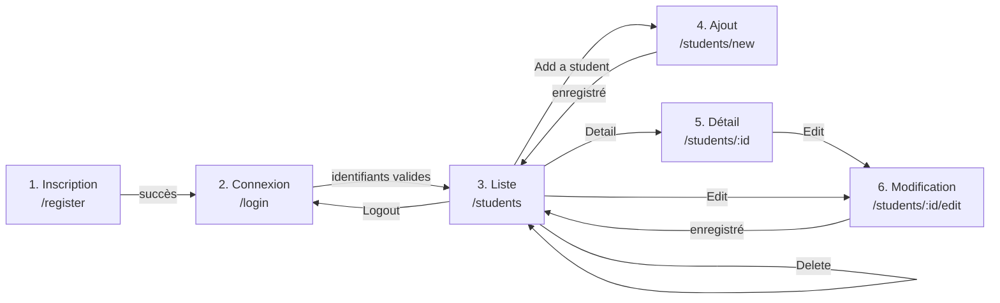
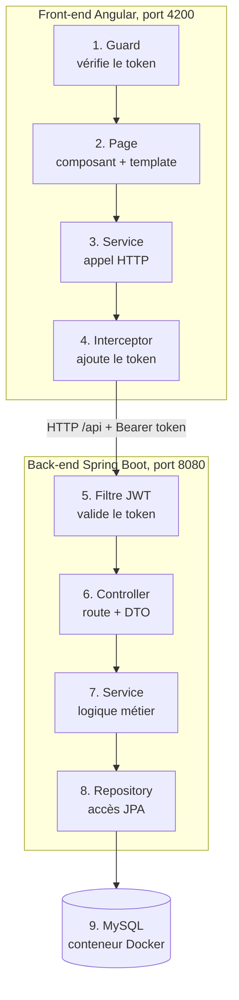
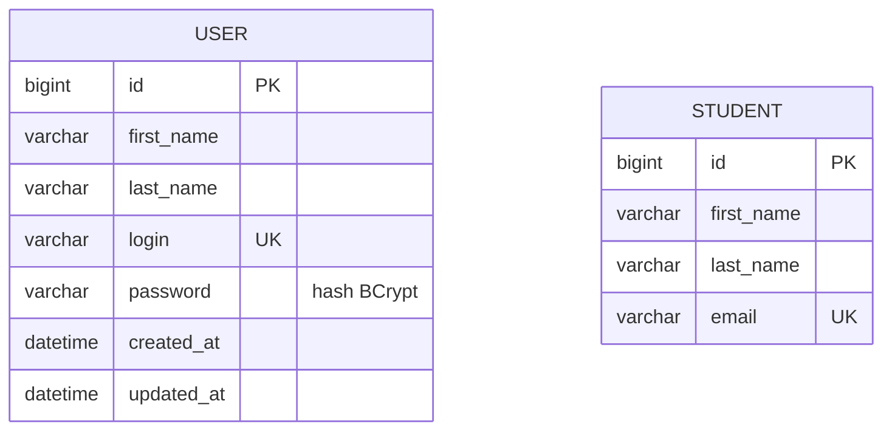

# Projet2

Application de gestion d'étudiants pour une bibliothèque.

- **Back-end** : Spring Boot 3.5, Java 21, Spring Security (JWT), JPA/Hibernate, MySQL
- **Front-end** : Angular 19, formulaires réactifs, Bootstrap
- **Tests** : JUnit et Mockito (back), Jest (front), Cypress (E2E)

## Sommaire

1. [Prérequis](#prérequis)
2. [Lancer l'application](#lancer-lapplication)
3. [Parcours des écrans](#parcours-des-écrans)
4. [Architecture](#architecture)
5. [Arborescence des fichiers](#arborescence-des-fichiers)
6. [Base de données MySQL](#base-de-données-mysql)
7. [API REST : toutes les routes](#api-rest--toutes-les-routes)
8. [Authentification JWT](#authentification-jwt)
9. [Routes et écrans Angular](#routes-et-écrans-angular)
10. [Tests](#tests)
11. [Dépannage](#dépannage)
12. [Choix et limites](#choix-et-limites)

## Prérequis

| Outil | Version | Pourquoi |
|---|---|---|
| JDK | 21 (actif dans le terminal) | compiler et lancer le back |
| Docker Desktop | démarré | conteneur MySQL et tests d'intégration |
| Node.js | 20 ou plus | front Angular et tests |
| npm | fourni avec Node | dépendances du front |

## Lancer l'application

### 1. Back-end

```bash
cd Back-end---Testez-et-am-liorez-une-application-existante
cp .env.example .env            # Windows : copy .env.example .env
./mvnw spring-boot:run          # Windows : mvnw.cmd spring-boot:run
```

- La première commande crée votre fichier `.env` local à partir du modèle `.env.example` : **à faire une seule fois, avant tout lancement et avant les tests**.
- Spring Boot démarre **automatiquement** le conteneur MySQL décrit dans `compose.yaml`.
- Les paramètres (base de données et secret JWT) sont lus dans le fichier `.env` du dossier du back. Ce fichier n'est pas versionné ; le modèle contient un secret factice de développement.
- L'API écoute sur **http://localhost:8080**.
- Lancez toujours la commande **depuis le dossier du back** : le fichier `.env` est lu depuis le dossier courant.

### 2. Front-end

```bash
cd Front-end---Testez-et-am-liorez-une-application-existante
npm install
npm start
```

- L'application est disponible sur **http://localhost:4200**.
- Les appels vers `/api` sont renvoyés au back (port 8080) par `proxy.conf.json`.

### 3. Exécuter les tests

Commandes, prérequis (Docker, `.env`, `npm start` pour Cypress) et rapports de couverture : voir la section [Tests](#tests).

### Récapitulatif

| Action | Dossier | Commande | Adresse ou rapport |
|---|---|---|---|
| Lancer le back-end (API + MySQL) | `Back-end---...` | `./mvnw spring-boot:run` | http://localhost:8080 |
| Lancer le front-end (Angular) | `Front-end---...` | `npm start` | http://localhost:4200 |
| Tests back-end + JaCoCo | `Back-end---...` | `./mvnw clean test` | `target/site/jacoco/index.html` |
| Tests front-end (Jest) | `Front-end---...` | `npm test` | `coverage/index.html` |
| Tests E2E (Cypress), `npm start` lancé | `Front-end---...` | `npm run e2e` | résultat dans le terminal |
| Tests E2E + couverture (port 4200 libre) | `Front-end---...` | `npm run e2e:coverage` | `coverage-e2e/index.html` |

MySQL (Docker) est démarré par le back, sur un port aléatoire visible dans Docker Desktop.

## Parcours des écrans

Dans l'ordre d'utilisation :



| # | Écran | Adresse | Accès | Ce qu'il fait |
|---|---|---|---|---|
| 1 | Inscription | `/register` | public | crée un compte agent, puis redirige vers la connexion avec un message vert |
| 2 | Connexion | `/login` | public | envoie les identifiants, stocke le token, redirige vers la liste |
| 3 | Liste des étudiants | `/students` | token requis | affiche les étudiants, boutons Detail, Edit, Delete, Add, Logout |
| 4 | Ajout | `/students/new` | token requis | formulaire de création |
| 5 | Détail | `/students/:id` | token requis | affiche un étudiant, bouton Edit |
| 6 | Modification | `/students/:id/edit` | token requis | formulaire pré-rempli |

Sans token, toute page protégée redirige vers `/login`. Un token expiré ou invalide (401) fait de même.

## Architecture



### Le trajet d'une requête

1. **Guard** : empêche d'ouvrir une page protégée sans token.
2. **Page** : le composant affiche l'écran et réagit aux actions.
3. **Service** : seul à connaître les URLs de l'API.
4. **Interceptor** : ajoute `Authorization: Bearer <token>` à chaque requête et redirige vers `/login` sur un 401.
5. **Filtre JWT** : vérifie la signature et l'expiration, charge l'utilisateur, remplit le contexte de sécurité.
6. **Controller** : reçoit la requête, valide le DTO, appelle le service.
7. **Service** : applique la logique métier (par exemple l'unicité de l'e-mail).
8. **Repository** : lit et écrit en base via JPA.
9. **MySQL** : stocke les données. La réponse suit le chemin inverse.

### Les couches du back-end

| Couche | Dossier | Rôle |
|---|---|---|
| Controller | `controller/` | routes HTTP, validation des entrées |
| Service | `service/` | logique métier, transactions |
| Repository | `repository/` | accès aux données (Spring Data JPA) |
| Entity | `entities/` | classes liées aux tables |
| DTO | `dto/` | objets qui entrent et sortent de l'API |
| Mapper | `mapper/` | conversion entité et DTO (MapStruct) |
| Handler | `handler/` | transforme les exceptions en réponses HTTP |
| Configuration | `configuration/` | sécurité, filtre JWT, chargement du `.env` |

## Arborescence des fichiers

```text
Projet2/
├── README.md
├── Back-end---Testez-et-am-liorez-une-application-existante/
│   ├── pom.xml                          dépendances Maven, JaCoCo, Testcontainers
│   ├── compose.yaml                     conteneur MySQL
│   ├── .env.example                     modèle des paramètres (base de données, secret JWT factice)
│   ├── .env                             votre copie locale du modèle, non versionnée
│   ├── lombok.config                    ignore le code généré par Lombok dans la couverture
│   ├── mvnw / mvnw.cmd                  wrapper Maven
│   └── src/
│       ├── main/
│       │   ├── resources/application.yml
│       │   └── java/com/openclassrooms/etudiant/
│       │       ├── EtudiantBackendApplication.java
│       │       ├── configuration/
│       │       │   ├── AppConfig.java                    charge le .env
│       │       │   ├── logging/RequestLoggingFilterConfig.java
│       │       │   └── security/
│       │       │       ├── SpringSecurityConfig.java     règles d'accès
│       │       │       ├── JwtAuthenticationFilter.java  filtre JWT
│       │       │       └── CustomUserDetailService.java  charge l'utilisateur
│       │       ├── controller/
│       │       │   ├── UserController.java               /api/register, /api/login
│       │       │   └── StudentController.java            /api/students
│       │       ├── service/
│       │       │   ├── UserService.java
│       │       │   ├── StudentService.java
│       │       │   └── JwtService.java                   génération et lecture du token
│       │       ├── repository/
│       │       │   ├── UserRepository.java
│       │       │   └── StudentRepository.java
│       │       ├── entities/
│       │       │   ├── User.java
│       │       │   └── Student.java
│       │       ├── dto/                                  RegisterDTO, LoginRequestDTO, LoginResponseDTO,
│       │       │                                         StudentRequestDTO, StudentResponseDTO
│       │       ├── mapper/                               UserDtoMapper, StudentDtoMapper
│       │       └── handler/                              RestExceptionHandler, ErrorDetails
│       └── test/java/com/openclassrooms/etudiant/        tests unitaires et d'intégration
│
└── Front-end---Testez-et-am-liorez-une-application-existante/
    ├── package.json
    ├── angular.json
    ├── proxy.conf.json                  /api vers localhost:8080
    ├── jest.config.js                   tests unitaires
    ├── cypress.config.ts                tests E2E
    ├── cypress/e2e/                     register.cy.ts, login.cy.ts, students.cy.ts
    ├── .nycrc.json                      couverture E2E (rapport coverage-e2e/)
    └── src/app/
        ├── app.routes.ts                routes et guard
        ├── app.config.ts                HttpClient et interceptor
        ├── core/
        │   ├── guard/auth.guard.ts
        │   ├── interceptor/auth.interceptor.ts
        │   ├── service/                 auth, user, student
        │   ├── models/                  Login, LoginResponse, Register, Student, StudentRequest
        │   └── utils/error-message.ts   message d'erreur affiché
        ├── pages/
        │   ├── register/
        │   ├── login/
        │   ├── student-list/
        │   ├── student-add/
        │   ├── student-detail/
        │   └── student-edit/
        └── shared/material.module.ts
```

## Base de données MySQL

Le conteneur MySQL est créé par Docker Compose. Les **tables sont générées par Hibernate** à partir des entités Java (`ddl-auto: update`) : aucun script SQL n'est nécessaire.



| Table | Contenu | Clé unique |
|---|---|---|
| `user` | les agents de la bibliothèque qui se connectent | `login` |
| `student` | les étudiants gérés par la bibliothèque | `email` |

- Les noms de colonnes sont en `snake_case` (`first_name`) : Spring convertit les noms des attributs Java (`firstName`).
- Il n'y a **aucun lien** entre les deux tables : tous les agents partagent la même liste d'étudiants.
- Les mots de passe sont stockés hachés (BCrypt), jamais en clair.
- Les données persistent grâce au volume Docker `db_data`.

Pour consulter la base : Docker Desktop, conteneur `mysql-1`, onglet `Exec`, puis :

```bash
mysql -u etudiant_db -p
use etudiant_db;
select * from student;
```

## API REST : toutes les routes

Adresse de base : `http://localhost:8080`

| Méthode | Route | Accès | Corps | Réponse |
|---|---|---|---|---|
| `POST` | `/api/register` | public | `RegisterDTO` | `201` sans corps |
| `POST` | `/api/login` | public | `LoginRequestDTO` | `200` avec `{ "token": "..." }` |
| `POST` | `/api/students` | token | `StudentRequestDTO` | `201` avec l'étudiant créé |
| `GET` | `/api/students` | token | aucun | `200` avec la liste |
| `GET` | `/api/students/{id}` | token | aucun | `200` avec l'étudiant |
| `PUT` | `/api/students/{id}` | token | `StudentRequestDTO` | `204` sans corps |
| `DELETE` | `/api/students/{id}` | token | aucun | `204` sans corps |

### Formats des objets

```json
// RegisterDTO
{ "firstName": "Jane", "lastName": "Doe", "login": "jane", "password": "secret" }

// LoginRequestDTO
{ "login": "jane", "password": "secret" }

// StudentRequestDTO
{ "firstName": "John", "lastName": "Smith", "email": "john.smith@mail.com" }

// StudentResponseDTO
{ "id": 1, "firstName": "John", "lastName": "Smith", "email": "john.smith@mail.com" }
```

Les champs sont tous obligatoires, et l'e-mail doit être valide.

### Codes d'erreur

| Code | Quand | Exemple de message |
|---|---|---|
| `400` | corps invalide, login ou e-mail déjà utilisé | `Email already used by another student` |
| `401` | pas de token, token invalide ou expiré, mauvais identifiants | `Invalid credentials` |
| `404` | étudiant introuvable | `Student not found with id 99999` |

Corps d'une erreur :

```json
{ "timestamp": "2026-10-12T11:07:40", "message": "Email already used by another student", "details": "uri=/api/students" }
```

### Exemple avec curl

```bash
# 1. Créer un compte
curl -X POST http://localhost:8080/api/register -H "Content-Type: application/json" \
  -d '{"firstName":"Jane","lastName":"Doe","login":"jane","password":"secret"}'

# 2. Se connecter : renvoie {"token":"..."}
curl -X POST http://localhost:8080/api/login -H "Content-Type: application/json" \
  -d '{"login":"jane","password":"secret"}'

# 3. Appeler une route protégée avec le token
curl http://localhost:8080/api/students -H "Authorization: Bearer <TOKEN>"
```

## Authentification JWT

1. `POST /api/login` : `UserService` vérifie le mot de passe avec BCrypt.
2. `JwtService` génère un token signé (HS512) contenant le login, la date d'émission et l'expiration (**1 heure**).
3. Le front stocke le token dans le `localStorage`.
4. L'interceptor l'envoie dans l'en-tête `Authorization: Bearer <token>`.
5. `JwtAuthenticationFilter` vérifie la signature et l'expiration, charge l'utilisateur et le place dans le contexte de sécurité.
6. `SpringSecurityConfig` exige un utilisateur authentifié sur toutes les routes sauf `/api/register` et `/api/login`.

L'application est **stateless** : aucune session côté serveur, le token accompagne chaque requête.

## Routes et écrans Angular

Définies dans `src/app/app.routes.ts` :

| Chemin | Composant | Protégé par `authGuard` |
|---|---|---|
| `register` | `RegisterComponent` | non |
| `login` | `LoginComponent` | non |
| `students` | `StudentListComponent` | oui |
| `students/new` | `StudentAddComponent` | oui |
| `students/:id/edit` | `StudentEditComponent` | oui |
| `students/:id` | `StudentDetailComponent` | oui |

L'ordre compte : `students/new` est déclaré avant `students/:id`, sinon « new » serait lu comme un identifiant.

## Tests

### Pyramide

| Niveau | Outil | Quantité | Ce qui est testé |
|---|---|---|---|
| Unitaire back | JUnit, Mockito | 16 | services, mapper, `CustomUserDetailService` |
| Intégration back | MockMvc, Testcontainers | 10 | controllers jusqu'à une vraie base MySQL |
| Unitaire et composants front | Jest | 56 | services, guard, interceptor, composants |
| E2E | Cypress | 21 | les 6 écrans, API simulée, couverture 89 % |

### Back-end

Docker doit être démarré (les tests d'intégration lancent un MySQL temporaire) et le fichier `.env` doit exister (voir « Lancer l'application »).

```bash
cd Back-end---Testez-et-am-liorez-une-application-existante
cp .env.example .env       # si ce n'est pas déjà fait
./mvnw clean test          # Windows : mvnw.cmd clean test
```

- Rapport de couverture JaCoCo : `target/site/jacoco/index.html`
- Couverture actuelle : **86 %** (seuil visé : 80 %)

### Front-end (Jest)

```bash
cd Front-end---Testez-et-am-liorez-une-application-existante
npm test
```

- Rapport : `coverage/index.html`
- Couverture actuelle : **94 %**

### E2E (Cypress)

Les appels à l'API sont simulés : le back n'a pas besoin d'être démarré.

```bash
# Terminal 1
cd Front-end---Testez-et-am-liorez-une-application-existante
npm start

# Terminal 2
cd Front-end---Testez-et-am-liorez-une-application-existante
npm run e2e
```

Pour voir les tests s'exécuter dans le navigateur : `npx cypress open`.

#### Couverture E2E

```bash
cd Front-end---Testez-et-am-liorez-une-application-existante
npm run e2e:coverage
```

Cette commande compile l'application, l'instrumente avec `nyc`, la sert sur le port 4200 et lance Cypress : arrêtez `npm start` avant, le port doit être libre.

- Rapport : `coverage-e2e/index.html`
- Couverture actuelle : **89 %** (seuil visé : 80 %)

## Dépannage

| Problème | Cause probable | Solution |
|---|---|---|
| `Permission denied` sur `./mvnw` | fichier non exécutable | `chmod +x mvnw` |
| Le back ou les tests ne démarrent pas, variables `${DB_*}` ou `${JWT_SECRET}` non résolues | fichier `.env` absent, ou lancé depuis un autre dossier que le back | `cp .env.example .env` et se placer dans le dossier du back |
| `No Docker Compose file found` | idem, mauvais dossier de travail | se placer dans le dossier du back |
| Erreur de compilation Lombok | JDK 25 utilisé à la place du 21 | activer le JDK 21 |
| Tests d'intégration en échec | Docker non démarré | démarrer Docker Desktop |
| `ng: command not found` | Angular CLI non installé globalement | utiliser `npm start` ou `npx ng` |
| Rien ne se passe à l'inscription | back non démarré ou login déjà utilisé | vérifier le back, lire le message rouge |

## Choix et limites

- **Token en `localStorage`** : simple, mais exposé en cas de faille XSS. Un cookie HttpOnly serait plus sûr.
- **Guard** : vérifie seulement la présence du token. La vraie sécurité est le filtre JWT côté serveur.
- **Étudiants partagés** : tous les agents voient la même liste. Pour cloisonner, il faudrait un propriétaire sur chaque étudiant.
- **Tables générées par Hibernate** (`ddl-auto: update`) : pratique en développement. En production, on préférerait des migrations versionnées (Flyway ou Liquibase).
- **E2E avec API simulée** : rapides et indépendants du back, mais ils ne testent pas le vrai back.
- **`.env` non versionné** : seul le modèle `.env.example` est dans le dépôt, avec un secret JWT factice. En production, les secrets seraient injectés par l'environnement.
